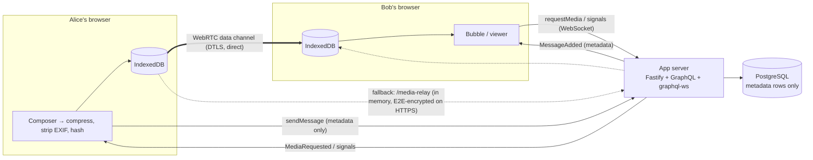

# MEDIA_PLAN.md: photos and videos, device to device

> **Status: implemented.** The sections below are the plan; "Deviations" at the end lists where the
> build differs from it. Paths are relative to the repo root.

## 0. In one minute

- People can send **photos and videos** (up to 10 per message, with an optional caption) in DMs and groups.
- **The bytes never live on the server.** The database stores only a small metadata row (type, size,
  dimensions, duration, SHA-256, a ~25-byte blur placeholder). No column can hold media, and a test enforces that.
- **Normal path, with the server as connector:** the sender's browser and the recipient's browser connect
  directly over **WebRTC data channels**. The server only passes the short handshake messages
  (offer, answer, ICE) over the WebSocket the app already has.
- **Fallback path, with the server as middleware:** if a direct connection can't be made (strict NAT,
  firewall, or a user who chose to hide their IP), the server **pipes the bytes between the two sockets
  in memory**. Nothing is written to disk or the database, and on HTTPS the frames are end-to-end
  encrypted, so the relay only sees ciphertext.
- **Media is pulled from whoever has it.** A recipient asks the server "who has attachment X?", the
  server asks the online devices of that chat's members, and the first device that has the file
  sends it. This can be the sender or anyone who already downloaded it, so group media stays available
  after the sender goes offline.
- **Honest trade-off:** with nothing stored on the server, media can only be downloaded while
  *someone who has it* is online. The UI says so in plain words ("Waiting for Alice to come online")
  and fills itself in automatically when they come back.



---

## 1. Guarantees and non-goals

### 1.1 What the server stores

| Stored (Postgres) | Never stored, anywhere on the server |
| --- | --- |
| `Message` row (sender, conversation, caption text, time) | Image or video bytes |
| `Attachment` rows: kind, MIME type, sanitized file name, byte size, width, height, video duration, SHA-256 of the file, SHA-256 + size + type of the video poster, ThumbHash (~25 bytes, an unrecognisable blur used for the placeholder) | Poster frames, thumbnails, previews |
| | Relay traffic (it only passes through RAM in 64 KiB frames and is never logged) |

Hard limits that make "no bytes on the server" physical, not just a convention. **Keep these.**

- Fastify `bodyLimit: 64 * 1024` (`apps/server/src/app.ts:41`): HTTP can't carry a file.
- graphql-ws `maxPayload: 64 * 1024` (`apps/server/src/app.ts:122`): the GraphQL socket can't carry one either.
- The relay endpoint has its own `maxPayload` (256 KiB per frame) and a per-relay byte cap. It has no disk or DB access.

### 1.2 Behaviour people will notice

- **The recipient is offline:** they get the message (placeholder, size, caption, unread badge) as soon
  as they're back, and the bytes as soon as a device that has them is online.
- **Everyone who has it is offline:** the tile says so and retries automatically when a chat member comes online.
- **Sign-out wipes this device's media** (the same privacy rule as drafts in `apps/web/src/lib/drafts.ts`).
  The sign-out button warns first.
- **P2P reveals IP addresses** to the other device (inherent to WebRTC). Settings has a
  "Hide my IP address" switch that forces the relay.

### 1.3 Non-goals for this version (see §13 for later)

Server-side moderation or scanning (impossible by design), offline delivery without any online holder,
video transcoding, stripping location metadata from *videos*, files other than photos and videos,
multi-instance deployments (same single-instance limit as presence today).

---

## 2. Decisions

| # | Question | Chosen | Why | Alternative if you disagree |
| --- | --- | --- | --- | --- |
| D1 | Transport | WebRTC `RTCDataChannel`, server does signaling only | Bytes skip the server; DTLS-encrypted | none |
| D2 | When P2P fails | Built-in in-memory WebSocket relay `/media-relay`, `MEDIA_RELAY=true` by default | Works behind strict NATs with no extra container | TURN server (coturn) via `ICE_SERVERS`; or no fallback |
| D3 | DB record | `Message` + `Attachment` metadata rows | Placeholders at exact size, unread counts, previews, and offline recipients learn the media exists | No row at all (live-only: offline people never know) |
| D4 | ThumbHash in DB | Yes (≤ 48 base64 chars) | Instant, colour-correct blur placeholder | Drop it: a neutral `bg-muted` placeholder |
| D5 | Delivery | **Pull** from any online member that has it | Group media survives the sender going offline | Push to online recipients only |
| D6 | Photos | Re-encode to WebP (JPEG/PNG fallback), long edge 2048 px; "HD" toggle → 4096 px | Removes EXIF/GPS and keeps files small | Send originals untouched |
| D7 | Videos | Sent byte-for-byte, ≤ 100 MB, poster frame extracted in the browser | In-browser transcoding is slow and heavy | WebCodecs transcode (later) |
| D8 | Local storage | IndexedDB per browser profile, wiped on sign-out | Matches the existing "next person on this device sees nothing" rule | Keep it per user id |
| D9 | Albums | Up to 10 attachments per message | One bubble and one caption, like other messengers | One attachment per message |
| D10 | Signaling channel | GraphQL **mutations over the existing graphql-ws socket**; events on the existing `events` subscription | No new infra; the device identity is tied to the socket | HTTP mutations plus a peer-id argument |
| D11 | Hashing | SHA-256 via `@noble/hashes` (pure JS, incremental) in a Web Worker | Works on plain-HTTP LAN deploys (no `crypto.subtle` there), streams big files, no WASM so the CSP stays unchanged | WebCrypto `digest` (secure context only, needs the whole file in memory) |

---

## 3. Architecture

### 3.1 Roles

- **Peer:** one signed-in browser tab. Each tab makes a random `peerId` (UUID v4) on page load and
  sends it in graphql-ws `connectionParams`. The server binds it to that socket and user.
- **Holder:** a peer whose IndexedDB (or memory, for a send in flight) holds the file *for that conversation*.
- **Requester:** a peer that wants an attachment.
- **Server:** checks membership, fans requests out to online member peers, forwards signals between
  the requester and candidates of a live request, and optionally relays.

### 3.2 Sending

1. The composer accepts files (picker, paste, or drag-and-drop) and runs the cheap checks synchronously (type, size, count).
2. The worker prepares each file: decode → resize/re-encode (photos) or extract the poster (videos) → ThumbHash → SHA-256.
3. On send, the pending bubble appears at once from local object URLs. When preparing finishes, the browser holds the bytes in
   memory (so it can serve immediately) and calls `sendMessage(conversationId, body, attachments)` with **metadata only**.
4. The server validates and stores the rows, then publishes `MessageAdded` as today.
5. On success the sender writes the bytes to IndexedDB tagged with the conversation id (`origin: 'sent'`).

### 3.3 Fetching

```mermaid
sequenceDiagram
  participant B as Bob's tab (requester)
  participant S as Server
  participant A as Alice's tab (holder)
  S-->>B: MessageAdded (attachments metadata + ThumbHash)
  B->>B: render blur placeholder at exact size
  B->>S: requestMedia(attachmentId, FILE)  [over WebSocket]
  S->>S: requireMember; candidates = online peers of members − Bob's tab
  S-->>A: MediaRequested(requestId, conversationId, sha256, fromPeer=B)
  A->>A: has sha256 for this conversation?
  A->>S: sendSignal(HAVE, {relayOnly:false})
  S-->>B: MediaSignal(HAVE, fromPeer=A)
  B->>S: sendSignal(OFFER, {connectionId, sdp})
  S-->>A: MediaSignal(OFFER)
  A->>S: sendSignal(ANSWER, {connectionId, sdp})
  S-->>B: MediaSignal(ANSWER)
  Note over A,B: ICE candidates trickle both ways through the server
  B->>A: data channel "get:<requestId>" → {t:"get", requestId, offset:0}
  A->>B: {t:"head"} · 64 KiB binary chunks · {t:"done"}
  B->>B: verify size + SHA-256 + file signature → IndexedDB
  B->>A: {t:"ok"}  (Bob is now a holder too)
```

If ICE doesn't reach `connected` within 8 s, or either side is relay-only: the requester calls
`openRelay(requestId, holderPeerId, key)`, both tabs open `wss://<host>/media-relay?relay=<id>&peer=<peerId>`,
and the same `get/head/chunks/done/ok` protocol runs over that socket (§3.6).

### 3.4 Signaling protocol

All three operations are GraphQL mutations sent **over the WebSocket** (graphql-ws runs mutations,
not only subscriptions). Over HTTP they fail with "Photos and videos need a live connection".

| Signal `type` | Direction | `payload` (JSON string, ≤ 16 KiB) |
| --- | --- | --- |
| `HAVE` | candidate → requester | `{"relayOnly": boolean}` |
| `OFFER` | requester → candidate | `{"connectionId": uuid, "sdp": string}` |
| `ANSWER` | candidate → requester | `{"connectionId": uuid, "sdp": string}` |
| `ICE` | either | `{"connectionId": uuid, "candidate": RTCIceCandidateInit \| null}` |
| `BYE` | either | `{"connectionId": uuid}` |
| `RELAY` | **server only**, emitted by `openRelay` to the holder | `{"relayId": uuid, "key": base64url \| ""}` |

Server rules for `sendSignal`:

1. The caller must be on a socket with a registered `peerId`. The server **stamps** `fromPeerId` and `fromUserId`.
2. `requestId` must be live (TTL 120 s).
3. The (from, to) pair must be (requester, candidate) or (candidate, requester), with the direction checked
   per type (table above). Anything else returns `FORBIDDEN`. This stops strangers from opening WebRTC
   connections to harvest IPs.
4. The payload is ≤ 16 KiB and is treated as opaque (never parsed or logged). Rate limit: 300 signals per 10 s per peer.

### 3.5 Transfer protocol (on an `RTCDataChannel` or a relay socket)

- One channel per transfer, label `get:<requestId>`, `ordered: true`, reliable, `binaryType = 'arraybuffer'`.
- Text frames are JSON control messages. Binary frames are file bytes.

```
requester → {"t":"get","requestId":"…","offset":0}
holder    → {"t":"head","size":123456,"mime":"image/webp"}
holder    → <ArrayBuffer 64 KiB> × N
holder    → {"t":"done"}
requester → {"t":"ok"}                      (after verification; the holder then closes the channel)
either    → {"t":"error","code":"UNAUTHORIZED"|"NOT_FOUND"|"BUSY"|"SIZE"|"HASH"|"TYPE"}
```

- **Chunk size:** `Math.min(65536, pc.sctp?.maxMessageSize || 65536)`.
- **Backpressure:** set `bufferedAmountLowThreshold = 1 MiB`. Pause when `bufferedAmount > 4 MiB` and resume on
  `bufferedamountlow`. Chrome closes a channel past 16 MiB buffered, so this matters.
- **Read-ahead:** the holder reads slice *n+1* (`blob.slice().arrayBuffer()`) while slice *n* is sending.
- **Verification by the receiver:** the received byte count equals `head.size`, which equals the metadata `size`. The
  incremental SHA-256 equals the metadata `sha256`. The magic bytes of the first chunk match the declared type
  (JPEG `FF D8 FF`, PNG `89 50 4E 47`, GIF `47 49 46 38`, WebP `RIFF…WEBP`, AVIF `ftypavif|ftypavis` at 4,
  MP4/MOV `ftyp` at 4, WebM `1A 45 DF A3`). Any mismatch discards the bytes and tries another holder.
- **Resume:** the receiving sink keeps its state for the session. If a channel drops, the next attempt
  (same or another holder: the content is the same, identified by its hash) sends `get` with `offset = received`.

### 3.6 Relay (fallback)

- `openRelay(requestId, holderPeerId, key)` is requester-only. The holder must be a candidate of that live request.
  The server creates `{relayId, a: requesterPeer, b: holderPeer, maxBytes, joinBy: now+20s}`, emits `RELAY` to
  the holder, and returns `relayId`.
- Both tabs connect to `/media-relay?relay=<relayId>&peer=<peerId>`. The upgrade is authenticated by the
  session cookie, the same-origin check, peer ownership, and membership of `{a, b}`. One socket per side.
- The server forwards every frame to the other side **as is**. Backpressure: count in-flight bytes per
  direction with the `ws.send(data, cb)` callback, `source.pause()` above 1 MiB in flight, and
  `source.resume()` below 256 KiB. (`ws@8.22.1` has `pause()` and `resume()`.)
- **Caps:** bytes from holder to requester ≤ `size + ceil(size / 65536) * 64 + 65536`, otherwise close `4413`.
  Close `4408` if the other side doesn't join within 20 s or no frame arrives for 30 s. Close `4403` on an auth failure.
- **Encryption:** on secure origins (`window.isSecureContext`), every relay frame is
  `iv(12) ‖ AES-256-GCM(type(1) ‖ payload)`. The IV is direction byte (`0x01` from requester, `0x02` from holder),
  then 3 random bytes per transfer, then a 64-bit counter. The requester generates the key, sends it in `openRelay`,
  and the server forwards it to the holder in the `RELAY` signal. This gives the same trust level as WebRTC
  (an *actively modified* server could intercept the signaling either way). A server that runs this code as
  written never sees plaintext. On plain HTTP the whole page is already cleartext, so frames are
  `type(1) ‖ payload` and `key` is `""`.

### 3.7 Security rules (each one has a test)

| # | Rule | Enforced in |
| --- | --- | --- |
| S1 | No media bytes accepted by HTTP or GraphQL; no `Bytes` column; `Attachment` columns match an allowlist | `app.ts` limits, `api.test.ts` "never stores media bytes" |
| S2 | `requestMedia` only for members (non-members get `NOT_FOUND`, which doesn't reveal that the attachment exists) | `services/media.ts` |
| S3 | Requests fan out only to online peers of *current* members; leaving a group cancels that user's live requests in it | `services/media.ts`, `conversations.leaveGroup` |
| S4 | A `peerId` is bound to one user. Claiming another user's `peerId` refuses the socket. Signals are stamped by the server | `services/peers.ts`, `app.ts onConnect` |
| S5 | Signals only within a live request, between its requester and candidates, with direction per type, size and rate capped | `services/media.ts sendSignal` |
| S6 | A holder serves **only** the `sha256` the server named, **only** to that request's requester peer, **only** if it holds the blob tagged with **that** conversation. This blocks "put a hash you guessed from another chat into a fake attachment" | `apps/web/src/features/media/serve.ts` |
| S7 | The receiver verifies size, SHA-256, and file signature | `apps/web/src/features/media/fetch.ts` |
| S8 | Type allowlist (no SVG, no HTML). Download file names get the extension of the verified type | server zod schema, `features/media/format.ts` |
| S9 | Photos are always re-encoded, which strips EXIF, GPS, and XMP | `features/media/prepare.ts` |
| S10 | The relay is bound to a relayId plus the 2 peers plus cookies, with caps and timeouts. It never logs or persists payloads | `apps/server/src/relay.ts` |
| S11 | IP disclosure explained; "Hide my IP address" means relay only, both as holder and requester | Settings, download manager, serve |
| S12 | Sign-out wipes IndexedDB media, object URLs, peer connections, and pending downloads | `features/media/index.ts` sign-out hook |
| S13 | CSP: only `blob:` added (to `img-src` and `media-src`) | `app.ts` |

### 3.8 Limits and constants

| Constant | Value | Lives in |
| --- | --- | --- |
| `maxAttachments` | 10 | server config → `mediaConfig` |
| `maxImageBytes` (after processing) | 20 MB (`MEDIA_MAX_IMAGE_MB`) | server config → `mediaConfig` |
| image input cap (before processing) | 50 MB | `features/media/limits.ts` |
| `maxVideoBytes` | 100 MB (`MEDIA_MAX_VIDEO_MB`) | server config → `mediaConfig` |
| poster | ≤ 512 KiB, long edge 640 px, WebP (JPEG fallback) q 0.8 | `limits.ts` + server zod |
| photo output | long edge 2048 px, WebP q 0.82; HD: 4096 px, q 0.9; JPEG fallback q 0.86; PNG if alpha | `limits.ts` |
| ThumbHash input | ≤ 100 × 100 px | `limits.ts` |
| chunk / high water / low water | 64 KiB / 4 MiB / 1 MiB | `limits.ts` |
| wait for `HAVE` | 1500 ms | `limits.ts` |
| ICE connect timeout | 8000 ms | `limits.ts` |
| idle peer connection close | 60 s with no open channels | `limits.ts` |
| request TTL | 120 s | `services/media.ts` |
| signal payload | ≤ 16 KiB | `services/media.ts` |
| rate limits | `requestMedia` 60 / 10 s per user · `sendSignal` 300 / 10 s per peer · `openRelay` 10 / 10 s per user, ≤ 4 concurrent relays per user | `services/media.ts` |
| downloads / serves per tab | 3 concurrent / 4 concurrent | `limits.ts` |
| auto-download video cap | 50 MB | `limits.ts` |
| unavailable auto-retry | on a member's presence going online, on reconnect, and every 60 s while visible | `downloads.ts` |

---

## 4. Phase 1: data model and message API (server)

### 4.1 Config: `apps/server/src/config.ts`

Add to the zod `schema` object:

```ts
MEDIA_ENABLED: z.preprocess(blankToUndefined, z.enum(['true', 'false']).default('true')),
MEDIA_RELAY: z.preprocess(blankToUndefined, z.enum(['true', 'false']).default('true')),
MEDIA_MAX_IMAGE_MB: z.preprocess(blankToUndefined, z.coerce.number().int().min(1).max(100).default(20)),
MEDIA_MAX_VIDEO_MB: z.preprocess(blankToUndefined, z.coerce.number().int().min(1).max(1024).default(100)),
// JSON array of RTCIceServer. Blank → public STUN. "[]" → host candidates only (LAN / tests).
ICE_SERVERS: z.preprocess(blankToUndefined, z.string().default('[{"urls":"stun:stun.l.google.com:19302"}]')),
```

After `env` is parsed, validate `ICE_SERVERS` with
`z.array(z.object({ urls: z.union([z.string(), z.array(z.string()).min(1)]), username: z.string().optional(), credential: z.string().optional() }))`
on `JSON.parse(env.ICE_SERVERS)`. On failure, print `  - ICE_SERVERS: must be a JSON array of {urls, username?, credential?}`
in the existing "Invalid configuration" format and `process.exit(1)`. Normalise `urls` to `string[]`.

Export:

```ts
media: {
  enabled: env.MEDIA_ENABLED === 'true',
  relay: env.MEDIA_RELAY === 'true',
  maxAttachments: 10,
  maxImageBytes: env.MEDIA_MAX_IMAGE_MB * 1024 * 1024,
  maxVideoBytes: env.MEDIA_MAX_VIDEO_MB * 1024 * 1024,
  maxPosterBytes: 512 * 1024,
  iceServers, // { urls: string[]; username?: string; credential?: string }[]
},
```

### 4.2 Prisma: `apps/server/prisma/schema.prisma`

```prisma
enum AttachmentKind {
  IMAGE
  VIDEO
}

model Message {
  // …existing fields…
  attachments Attachment[]
}

/// Metadata only. The bytes live on people's devices and travel device to device.
/// Never add a Bytes column here (api.test.ts guards this).
model Attachment {
  id           String         @id @default(cuid())
  messageId    String
  position     Int
  kind         AttachmentKind
  mimeType     String
  name         String
  size         Int
  width        Int
  height       Int
  durationMs   Int?
  sha256       String
  thumbhash    String?
  posterSha256 String?
  posterSize   Int?
  posterMime   String?

  message Message @relation(fields: [messageId], references: [id], onDelete: Cascade)

  @@unique([messageId, position])
}
```

Run `npm run db:migrate -w apps/server -- --name media_attachments` and commit
`apps/server/prisma/migrations/<timestamp>_media_attachments/migration.sql`. Expected content:
`CREATE TYPE "AttachmentKind"`, `CREATE TABLE "Attachment"`, the unique index
`Attachment_messageId_position_key`, and an FK to `Message` with `ON DELETE CASCADE`.

### 4.3 Shared include: `apps/server/src/types.ts`

```ts
import type { Prisma, User } from '@prisma/client';

export const messageInclude = {
  sender: true,
  attachments: { orderBy: { position: 'asc' } },
} satisfies Prisma.MessageInclude;

export type MessageWithSender = Prisma.MessageGetPayload<{ include: typeof messageInclude }>;
```

(`types.ts` now exports a value, so use a normal `import` where you need `messageInclude`.) Then use it in:
- `services/conversations.ts` `include.messages.include` → `messageInclude`
- `services/messages.ts` `listMessages` `include` and `sendMessage` `create.include` → `messageInclude`

### 4.4 Validation and send: `apps/server/src/services/messages.ts`

Replace `bodySchema` with a caption schema, then require "text or at least one attachment":

```ts
const captionSchema = z.string().transform((s) => s.trim()).pipe(
  z.string().max(4000, 'Messages can be up to 4000 characters'),
);
const SHA256 = /^[0-9a-f]{64}$/;
const THUMBHASH = /^[A-Za-z0-9+/]{1,64}={0,2}$/;
const dim = z.number().int().min(1).max(16384);
const fileName = (fallback: string) =>
  z.string().transform((s) =>
    s.normalize('NFC').replace(/[\u0000-\u001f\u007f/\\]/g, '').trim().slice(0, 120) || fallback,
  );
const mb = (bytes: number) => Math.round(bytes / 1024 / 1024);

const imageSchema = z.object({
  kind: z.literal('IMAGE'),
  mimeType: z.enum(['image/jpeg', 'image/png', 'image/webp', 'image/gif', 'image/avif']),
  name: fileName('photo'),
  size: z.number().int().min(1).max(config.media.maxImageBytes, `Photos can be up to ${mb(config.media.maxImageBytes)} MB`),
  width: dim, height: dim,
  sha256: z.string().regex(SHA256, 'Invalid file hash'),
  thumbhash: z.string().regex(THUMBHASH).nullish(),
});
const videoSchema = z.object({
  kind: z.literal('VIDEO'),
  mimeType: z.enum(['video/mp4', 'video/webm', 'video/quicktime']),
  name: fileName('video'),
  size: z.number().int().min(1).max(config.media.maxVideoBytes, `Videos can be up to ${mb(config.media.maxVideoBytes)} MB`),
  width: dim, height: dim,
  durationMs: z.number().int().min(0).max(3 * 60 * 60 * 1000),
  sha256: z.string().regex(SHA256, 'Invalid file hash'),
  thumbhash: z.string().regex(THUMBHASH).nullish(),
  posterSha256: z.string().regex(SHA256, 'Invalid poster hash'),
  posterSize: z.number().int().min(1).max(config.media.maxPosterBytes),
  posterMime: z.enum(['image/jpeg', 'image/webp']),
});
const attachmentsSchema = z
  .array(z.discriminatedUnion('kind', [imageSchema, videoSchema]))
  .max(config.media.maxAttachments, `You can send up to ${config.media.maxAttachments} at a time`);
```

`sendMessage(userId, conversationId, body, attachments?: unknown)`:

1. `text = parseInput(captionSchema, body)` and `list = parseInput(attachmentsSchema, attachments ?? [], 'attachments')`.
2. If `!text && list.length === 0`, throw `fail('BAD_USER_INPUT', 'Write a message first')`. This keeps today's test green.
3. If `list.length && !config.media.enabled`, throw `fail('FORBIDDEN', 'Photos and videos are turned off on this server')`.
4. `requireMember`, then the rate limit (unchanged).
5. In the existing `$transaction`, `prisma.message.create({ data: { …, body: text, attachments: { create: list.map((a, position) => ({ ...toRow(a), position })) } }, include: messageInclude })`.
   `toRow` sets `durationMs/posterSha256/posterSize/posterMime` to `null` for images.

### 4.5 Schema and resolvers: `apps/server/src/schema.ts`, `resolvers.ts`

SDL additions (Phase 1 part):

```graphql
type Query {
  "Limits and connection settings for photos and videos. Requires sign-in."
  mediaConfig: MediaConfig!
}
type Mutation {
  sendMessage(conversationId: ID!, body: String!, attachments: [AttachmentInput!]): Message!
}
enum AttachmentKind { IMAGE VIDEO }
"Metadata only: the bytes travel device to device and are never stored on the server."
type Attachment {
  id: ID!
  kind: AttachmentKind!
  mimeType: String!
  name: String!
  size: Int!
  width: Int!
  height: Int!
  durationMs: Int
  sha256: String!
  thumbhash: String
  posterSha256: String
  posterSize: Int
  posterMime: String
}
input AttachmentInput {
  kind: AttachmentKind!
  mimeType: String!
  name: String!
  size: Int!
  width: Int!
  height: Int!
  durationMs: Int
  sha256: String!
  thumbhash: String
  posterSha256: String
  posterSize: Int
  posterMime: String
}
type IceServer { urls: [String!]! username: String credential: String }
type MediaConfig {
  enabled: Boolean!
  relay: Boolean!
  maxAttachments: Int!
  maxImageBytes: Int!
  maxVideoBytes: Int!
  iceServers: [IceServer!]!
}
type Message { … attachments: [Attachment!]! }
```

Resolvers:
- `Query.mediaConfig: (_, __, ctx) => (requireUser(ctx), { ...config.media })`
- `Mutation.sendMessage`: pass `args.attachments` through.
- `Message.attachments: (m) => m.attachments ?? []`

### 4.6 Tests (Phase 1)

In `apps/server/test/helpers.ts` `resetDb`, add `await prisma.attachment.deleteMany()` first.

In `apps/server/test/api.test.ts`, add `describe('media metadata')`:
1. **sends a photo with no caption.** One IMAGE attachment and `body: ''` returns `attachments[0]` with every field.
   `messages` and `conversations { lastMessage { attachments { id } } }` include it.
2. **validates attachments** (table-driven): a bad sha (`'xyz'`), `image/svg+xml`, an image over the max, a VIDEO without
   `posterSha256`, 11 attachments, `kind: IMAGE` with `video/mp4`. Each expects `BAD_USER_INPUT`. The name `'../../a\u0000b.jpg'`
   is stored as `'....ab.jpg'`. Whitespace-only body with no attachments still returns `BAD_USER_INPUT`.
3. **never stores media bytes:** `Prisma.dmmf.datamodel.models` has no field of `type === 'Bytes'`, and the
   `Attachment` field names equal the exact allowlist from §4.2 (sorted array snapshot). A new column means
   consciously editing this test.
4. **mediaConfig needs sign-in** and returns the limits. With `config.media.enabled = false` (restored in `finally`),
   sending an attachment returns `FORBIDDEN`.

**Check:** `npm test -w apps/server` and `npm run typecheck` pass. The existing tests are unchanged.

---

## 5. Phase 2: signaling on the server

### 5.1 Peer registry: `apps/server/src/services/peers.ts` (new)

```ts
import type { WebSocket } from 'ws';

export const PEER_ID = /^[0-9a-f]{8}-[0-9a-f]{4}-4[0-9a-f]{3}-[89ab][0-9a-f]{3}-[0-9a-f]{12}$/;
export interface Peer { peerId: string; userId: string; socket: WebSocket }

const peers = new Map<string, Peer>();
const byUser = new Map<string, Set<string>>();

/** false = this peerId belongs to someone else (refuse the socket). A reconnect by the same user replaces it. */
export function registerPeer(peerId: string, userId: string, socket: WebSocket): boolean;
/** Removes the peer only if `socket` is still the one registered (late closes after a reconnect are ignored). */
export function unregisterPeer(peerId: string, socket: WebSocket): void;
export function getPeer(peerId: string): Peer | undefined;
export function peersOfUsers(userIds: Iterable<string>): Peer[];
export function clearPeers(): void; // tests
```

### 5.2 WebSocket context: `apps/server/src/app.ts` and `context.ts`

- `Context` gains `peerId: string | null`. The HTTP context sets `peerId: null`.
- Add `export function requirePeer(ctx): string` to `context.ts`. It throws
  `fail('BAD_USER_INPUT', 'Photos and videos need a live connection. Reconnect and try again.')`.
- In `useServer.onConnect`, after `userId`:
  ```ts
  const raw = (ctx.connectionParams as { peerId?: unknown } | undefined)?.peerId;
  const peerId = typeof raw === 'string' && PEER_ID.test(raw) ? raw : null;
  if (peerId && !registerPeer(peerId, userId, ctx.extra.socket)) return false; // → 4403
  socketPeers.set(ctx.extra.socket, peerId);
  ```
  Sockets without a `peerId` still work; they just can't use media.
- `onClose`: `unregisterPeer(peerId, socket)` and `closeRelaysOf(peerId)` (Phase 6).
- `context`: add `peerId: socketPeers.get(ctx.extra.socket) ?? null`.

### 5.3 Peer-targeted events: `apps/server/src/types.ts`, `pubsub.ts`, `resolvers.ts`

```ts
// types.ts ServerEvent additions
| { __typename: 'MediaRequested'; toPeerId: string; requestId: string; conversationId: string;
    attachmentId: string; part: 'FILE' | 'POSTER'; sha256: string; fromUserId: string; fromPeerId: string }
| { __typename: 'MediaSignal'; toPeerId: string; requestId: string;
    type: 'HAVE' | 'OFFER' | 'ANSWER' | 'ICE' | 'BYE' | 'RELAY'; payload: string; fromUserId: string; fromPeerId: string }
```

- `pubsub.ts`: add `publishToPeer(peer: Peer, event)`, which is `pubsub.publish(userTopic(peer.userId), event)`.
- `resolvers.ts` `Subscription.events.subscribe` filters on the server, so a tab only receives its own peer events:

```ts
import { filter, pipe } from 'graphql-yoga';
// …
subscribe: (_: unknown, __: unknown, ctx: Context) => {
  if (!ctx.userId) throw fail('UNAUTHENTICATED', 'Please sign in to continue');
  const me = ctx.peerId;
  return pipe(
    pubsub.subscribe(userTopic(ctx.userId)),
    filter((e: ServerEvent) => !('toPeerId' in e) || e.toPeerId === me),
  );
},
```

(Yoga also serves subscriptions over SSE. There `ctx.peerId` is `null`, so peer events never leak to it.)

### 5.4 Media service: `apps/server/src/services/media.ts` (new)

```ts
interface PendingRequest {
  id: string; attachmentId: string; conversationId: string; part: 'FILE' | 'POSTER';
  sha256: string; size: number; requesterUserId: string; requesterPeerId: string;
  candidates: Set<string>; expiresAt: number;
}
const REQUEST_TTL_MS = 120_000;
const requests = new Map<string, PendingRequest>();
// sweep expired every 30 s: setInterval(...).unref()

export async function requestMedia(ctx: Context, attachmentId: string, part: 'FILE' | 'POSTER')
  : Promise<{ requestId: string; candidates: number }>;
export function sendSignal(ctx: Context, input: unknown): boolean;
export function openRelay(ctx: Context, requestId: string, holderPeerId: string, key: string | null): string; // Phase 6
export function cancelRequestsFor(conversationId: string, userId: string): void;
export function resetMediaState(): void; // tests: requests, relays, limiters
```

`requestMedia` steps, in order:
1. `requireUser`, `requirePeer`. If `!config.media.enabled`, `FORBIDDEN`. Rate limit 60 / 10 s per user.
2. `prisma.attachment.findUnique({ where: { id }, include: { message: { select: { conversationId: true } } } })`. Missing → `NOT_FOUND`.
3. `requireMember(userId, conversationId)` (`NOT_FOUND` for non-members, same wording as conversations).
4. `part === 'POSTER'` requires `posterSha256`, otherwise `BAD_USER_INPUT`. Pick `sha256` and `size` for the part.
5. `candidates = peersOfUsers(await memberIds(conversationId)).filter(p => p.peerId !== requesterPeerId)`.
   The requester's *own other tabs* are included.
6. Store the `PendingRequest` (`id = randomUUID()`). For each candidate, `publishToPeer(c, { __typename: 'MediaRequested', … })`.
7. Return `{ requestId, candidates: candidates.length }`.

`sendSignal(input)`: validate with zod `{ requestId: uuid, toPeerId: PEER_ID, type: enum(HAVE|OFFER|ANSWER|ICE|BYE), payload: string max 16384 }`,
then apply the rules in §3.4. If the target peer is gone, return `false`. Otherwise `publishToPeer(target, { __typename: 'MediaSignal', …, fromUserId, fromPeerId })`
and return `true`.

`conversations.leaveGroup`: call `cancelRequestsFor(conversationId, userId)` after deleting the membership.

### 5.5 SDL (Phase 2 part) and resolvers

```graphql
enum MediaPart { FILE POSTER }
enum SignalType { HAVE OFFER ANSWER ICE RELAY BYE }
input SignalInput { requestId: ID! toPeerId: ID! type: SignalType! payload: String! }
type MediaRequest { requestId: ID! candidates: Int! }

type Mutation {
  "Live connection only. Asks the online devices of this chat's members who has the attachment."
  requestMedia(attachmentId: ID!, part: MediaPart!): MediaRequest!
  "Live connection only. Passes a WebRTC signal to a device taking part in a live media request."
  sendSignal(input: SignalInput!): Boolean!
}

union ChatEvent = MessageAdded | ConversationUpdated | TypingStarted | PresenceChanged | MediaRequested | MediaSignal
type MediaRequested { requestId: ID! conversationId: ID! attachmentId: ID! part: MediaPart! sha256: String! fromUserId: ID! fromPeerId: ID! }
type MediaSignal { requestId: ID! type: SignalType! payload: String! fromUserId: ID! fromPeerId: ID! }
```

### 5.6 Tests (Phase 2): `apps/server/test/realtime.test.ts`

Extend `listen(cookie, peerId?)` to pass `connectionParams: { peerId }`. Add `client.request(query, vars)`, which runs a mutation over
that same graphql-ws client and resolves the single result. Add `resetMediaState()` and `clearPeers()` to `resetDb`.

1. **fans out to other members' online devices only.** Alice sends a photo. Peers: Alice A1; Bob B1 and B2; Eve E1 (not a member).
   B1 calls `requestMedia`, which returns `candidates: 2`. A1 and B2 get `MediaRequested` with the right `sha256` and `conversationId`.
   B1 and E1 get nothing.
2. **non-members can't request:** E1 gets `NOT_FOUND`.
3. **signals flow only inside the request and are stamped:** A1 sends `HAVE` to B1, and B1 receives it with `fromPeerId: A1, fromUserId: alice`.
   E1 sending to B1 with that `requestId` gets `FORBIDDEN`. A1 sending `OFFER` (wrong direction) gets `FORBIDDEN`. A 16 385-byte payload gets
   `BAD_USER_INPUT`. `RELAY` via `sendSignal` gets `BAD_USER_INPUT`.
4. **requests expire:** `vi.useFakeTimers({ toFake: ['Date'] })`, advance 121 s, then `sendSignal` gets `FORBIDDEN`.
5. **peer ids can't be hijacked:** Eve connects with A1's `peerId` and gets a connection error (4403).
6. **leaving a group cancels requests:** a group request, then the requester leaves, then the holder's `HAVE` gets `FORBIDDEN`.
7. **HTTP is refused:** `requestMedia` over `Client.gql` (HTTP) gets `BAD_USER_INPUT` "need a live connection".

**Check:** `npm test -w apps/server` passes.

---

## 6. Phase 3: client media core (no UI)

### 6.1 Dependencies

```bash
npm i -w apps/web idb@^8 thumbhash@^0.1 @noble/hashes@^1.8
```

`@noble/hashes@1.x` exports `sha256` from `@noble/hashes/sha2`. If npm resolves 2.x, the path is `@noble/hashes/sha2.js`.

### 6.2 Files (all new, under `apps/web/src/features/media/`)

| File | Purpose |
| --- | --- |
| `limits.ts` | Constants from §3.8 (client side) |
| `peerId.ts` | `export const peerId` is a UUID v4 from `crypto.getRandomValues`. Don't use `randomUUID`, which needs a secure context and would break plain-HTTP LAN deploys |
| `config.ts` | `loadMediaConfig(client)`: memoized `client.query(MEDIA_CONFIG)`. `useMediaConfig()` hook. `resetMediaConfig()` |
| `wsRequest.ts` | `wsRequest(doc, vars, timeoutMs = 10_000)`: one mutation over `wsClient.subscribe({ query: print(doc), variables })`, resolves on `complete`, rejects on errors or timeout |
| `store.ts` | IndexedDB store, in-memory index, memory holds, object-URL cache, cross-tab sync |
| `media.worker.ts` + `worker.ts` | Worker for hashing, image re-encode (OffscreenCanvas), ThumbHash, and the receiving sink. `worker.ts` is a typed RPC wrapper with a main-thread fallback (used by jsdom tests and browsers without OffscreenCanvas `convertToBlob`) |
| `prepare.ts` | `accept()` (sync checks) and `prepare(file, { hd })` (async pipeline) |
| `format.ts` | `formatBytes`, `formatDuration`, `extensionFor(mime)`, `sniff(bytes, mime)` |
| `channel.ts` | The `Channel` interface plus adapters for `RTCDataChannel` and the relay socket |
| `serve.ts` / `fetch.ts` | Holder and requester sides of §3.5 |
| `signals.ts` | Incoming `MediaRequested`/`MediaSignal` handling, the `HAVE` collector, the authorised-request table |
| `peer.ts` | `RTCPeerConnection` lifecycle (Phase 4) |
| `relay.ts` | Relay client and AES-GCM framing (Phase 6) |
| `downloads.ts` / `transfers.ts` | Download manager and outgoing-share progress stores (Phase 4) |
| `prefs.ts` | `media:autodownload` (`all`/`photos`/`off`, default `photos`), `media:relayOnly`, `media:intro-seen`. Same `useSyncExternalStore` pattern as `lib/sounds.ts` |
| `trayStore.ts` | Per-conversation composer tray (in memory, survives chat switches) |
| `index.ts` | `initMedia(client)`, `shutdownMedia()`, re-exports |

### 6.3 Wire-up in existing files

- `apps/web/src/lib/apollo.ts` → `createClient({ …, connectionParams: () => ({ peerId }) })`.
- **Sign-out without an import cycle:** media imports `wsClient` from `apollo.ts`, so `apollo.ts` must not import media.
  Add `apps/web/src/lib/sessionHooks.ts` with `onSignOut(fn)` and `runSignOutHooks()`. `resetSession()` calls
  `await runSignOutHooks()` next to `clearDrafts()`. `features/media/index.ts` registers `shutdownMedia` at import.
- `apps/web/src/lib/gql.ts`: add the `Attachment` interface plus `AttachmentFields` fragment. Add `attachments { ...AttachmentFields }` to
  `MESSAGE_FIELDS`. `SEND_MESSAGE` gains `$attachments: [AttachmentInput!]`. Add `MEDIA_CONFIG`, `REQUEST_MEDIA`, `SEND_SIGNAL`,
  `OPEN_RELAY` documents, plus the `MediaRequested` and `MediaSignal` members in `ChatEvent` and `EVENTS`.

### 6.4 Store: `store.ts`

```ts
interface MediaRecord {
  sha256: string; blob: Blob; mime: string; size: number;
  conversationIds: string[]; origin: 'sent' | 'received'; savedAt: number;
}
// openDB('realtime-media', 1): store 'blobs' keyPath 'sha256', index 'byConversation' on conversationIds { multiEntry: true }

loadIndex(): Promise<void>               // keys + conversationIds → memory; awaited by every holder check
has(sha, conversationId?): boolean       // sync, for rendering
hasAsync(sha, conversationId?): Promise<boolean> // memory || IDB (another tab may have written it)
get(sha): Promise<Blob | undefined>      // memory hold first, then IDB
holdInMemory(sha, blob, conversationId)  // a send in flight: servable before IDB has it
persist(sha, conversationId, origin)     // memory → IDB; first call does navigator.storage?.persist?.()
put(sha, blob, mime, conversationId, origin)
releaseMemory(sha)                       // a discarded pending send
urlFor(sha): Promise<string>             // cached object URL per sha for the session
registerUrl(sha, url)                    // reuse the composer's preview URL, so no flicker after "sent"
forgetConversation(id)                   // drop id from records; delete records left with none
usage(): Promise<{ bytes: number; photos: number; videos: number; quota?: number }>
clearAll(): Promise<void>                // deleteDB, clear maps, revoke URLs
```

- Cross-tab sync: `BroadcastChannel('realtime-media')` posts `{put|delete|clear, sha?}` and updates the other tabs' memory indexes.
- `QuotaExceededError` on put → toast "This device is out of space for photos and videos. Clear some in Settings."
- If IndexedDB is unavailable, use a memory-only fallback (media lasts for the tab session).

### 6.5 Prepare: `prepare.ts`

`accept(files, alreadyInTray, cfg) → { accepted: File[]; rejected: { file; reason }[] }` runs synchronously and in this order:
1. Count: cap at `cfg.maxAttachments - alreadyInTray`; the rest are rejected with "You can send up to 10 at a time."
2. Type: use `file.type`, else infer from the extension (`.heic/.heif` → image, `.mov` → `video/quicktime`, `.m4v` → `video/mp4`).
   Not image or video → "“{name}” can’t be sent. Use a JPEG, PNG, WebP, GIF, MP4 or WebM file."
3. Size: image input > 50 MB, or GIF > `maxImageBytes` → "“{name}” is too large. Photos can be up to {n} MB."
   Video > `maxVideoBytes` → "… Videos can be up to {n} MB."

`prepare(file, { hd }) → { localId, kind, previewUrl, done: Promise<PreparedAttachment> }`:

**Photo**
1. `previewUrl = URL.createObjectURL(file)` immediately.
2. Worker: `createImageBitmap(file, { imageOrientation: 'from-image' })`. Failure → `UNSUPPORTED` ("can’t be sent…").
3. GIF: pass the bytes through untouched (re-encoding loses animation; GIFs carry no GPS EXIF).
4. Otherwise scale to long edge ≤ 2048 (HD 4096), never upscaling. Draw on `OffscreenCanvas`.
   `convertToBlob({ type: 'image/webp', quality })`. If `blob.type !== 'image/webp'` (older Safari), use PNG when any
   alpha < 255 in the ThumbHash sample, otherwise JPEG q 0.86.
5. ThumbHash: draw ≤ 100 × 100, `getImageData`, `rgbaToThumbHash`, then base64.
6. SHA-256: stream the output in 4 MiB slices into `sha256.create()`.
7. Resolve `{ kind: 'IMAGE', file: output, mimeType: output.type, name: replaceExt(file.name, mime), size, width, height, sha256, thumbhash, previewUrl }`.

**Video** (main thread, because it needs `<video>`)
1. `<video muted playsInline preload="metadata" src=objectURL>` and await `loadedmetadata` (8 s timeout).
   Failure → "“{name}” can’t be read in this browser. Try an MP4 (H.264) video."
2. Seek to `Math.min(1, duration * 0.1)`. On `seeked`, draw to canvas (long edge 640) → poster WebP q 0.8 (JPEG fallback)
   → `posterSha256`, `posterSize`. Take the ThumbHash from the same frame.
3. SHA-256 of the file (worker, streamed). **Bytes untouched.**
4. `previewUrl` = the poster object URL. Resolve with `durationMs = Math.round(duration * 1000)` and `poster: { blob, mime, size, sha256 }`.

### 6.6 Transfer core: `channel.ts`, `serve.ts`, `fetch.ts`

```ts
export interface Channel {
  send(data: string | ArrayBuffer): void;
  readonly bufferedAmount: number;
  bufferedAmountLowThreshold: number;
  onbufferedamountlow: (() => void) | null;
  onmessage: ((data: string | ArrayBuffer) => void) | null;
  onclose: (() => void) | null;
  readonly maxMessageSize: number;
  close(): void;
}
```

- `serve(channel, remotePeerId)` waits for `get`, then looks up `authorized.get(requestId)`, which was set when this tab answered
  `MediaRequested`. It checks `auth.requesterPeerId === remotePeerId`, not expired, and
  `store.hasAsync(auth.sha256, auth.conversationId)`. Otherwise it sends `error` and closes. Then it streams per §3.5 with ≤ 4 serves
  per tab (extra ones wait in a FIFO), and reports progress to `transfers.ts`.
- `fetchOver(channel, { requestId, offset, expected: { sha256, size, mime } }, sink, onProgress) → Promise<Blob>`. The `sink`
  lives in the worker. Chunks are **transferred** to it (zero-copy), it hashes incrementally, and `finish()` returns
  `{ sha256, blob }`. That keeps 100 MB videos off the main thread.

### 6.7 Tests (Phase 3, Vitest/jsdom)

- `format.test.ts`: `formatBytes` (`0 → "0 B"`, `1536 → "1.5 KB"`, `18_400_000 → "18 MB"`), `formatDuration`
  (`42_000 → "0:42"`, `725_000 → "12:05"`, `3_753_000 → "1:02:33"`), `sniff` for every allowed type plus an HTML impostor.
- `prepare.test.ts`: `accept()` ordering, extension inference, every limit message.
- `transfer.test.ts`: an in-memory channel pair that simulates `bufferedAmount`. Cases: a full transfer; resume after a
  drop at 40 %; hash mismatch → `HASH`; size mismatch → `SIZE`; wrong requester → `UNAUTHORIZED`; a blob tagged with
  another conversation → `NOT_FOUND` (S6); a sniff failure → `TYPE`; the holder never exceeds the high-water mark.
- `store.test.ts` (with `fake-indexeddb` as a dev dependency): put/has/forgetConversation/clearAll, and the multi-conversation tag.

**Check:** `npm test -w apps/web` and `npm run typecheck` pass.

---

## 7. Phase 4: WebRTC transport and download manager

### 7.1 `peer.ts`

```ts
class PeerLink {
  connectionId: string; remotePeerId: string; requestId: string; role: 'requester' | 'holder';
  pc: RTCPeerConnection; openChannels: number; lastUsed: number;
}
const links = new Map<string, PeerLink>();        // by connectionId
const outgoing = new Map<string, PeerLink>();     // requester side, by remotePeerId (reused)

export async function openChannel(remotePeerId: string, requestId: string): Promise<Channel>;
export function onOffer(signal): Promise<void>;   // holder
export function onAnswer(signal): void;
export function onIce(signal): void;              // queue until remoteDescription is set
export function onBye(signal): void;
export function closeAll(): void;
```

- **Requester:** reuse `outgoing.get(remotePeerId)` if `connectionState === 'connected'`, and open
  `pc.createDataChannel('get:' + requestId, { ordered: true })` on it. That needs no renegotiation (SCTP).
  Otherwise create a `pc` with `{ iceServers }` from `mediaConfig`, create the data channel **before** `createOffer()`,
  `setLocalDescription`, send `OFFER`, and trickle `ICE` (`onicecandidate`, `null` = end). Reject with `ICE_TIMEOUT` if it isn't
  `connected` within 8 s.
- **Holder:** on `OFFER`, require `authorized.has(requestId)` with a matching `fromPeerId` and **not** `prefs.relayOnly`
  (otherwise send `BYE`). Then `setRemoteDescription`, `createAnswer`, send `ANSWER`, trickle ICE, and
  `pc.ondatachannel = (e) => serve(adapt(e.channel), remotePeerId)`.
- Close after 60 s with no open channels (`pc.close()` and `BYE`). `closeAll()` runs on sign-out.

### 7.2 `downloads.ts`: one store, `useSyncExternalStore`

```ts
type Status = 'idle' | 'queued' | 'locating' | 'connecting' | 'downloading' | 'ready' | 'unavailable' | 'failed';
interface Entry {
  key: string;            // sha256 of the part (dedupes identical files)
  attachmentId: string; part: 'FILE' | 'POSTER'; conversationId: string;
  status: Status; progress: number; url?: string; transport?: 'p2p' | 'relay'; error?: string;
  priority: number;       // 100 viewer open · 50 on screen · 10 prefetch
  attempts: number; triedHolders: Set<string>;
}
ensure(att, part, conversationId, priority): void
cancel(key): void         // videos only (UI ×)
retry(key): void          // manual tap
onPresence(userId): void  // a member came online → requeue that conversation's 'unavailable' (debounced 1 s)
onReconnect(): void       // requeue all 'unavailable'
useDownload(key): Entry | undefined
```

`run(entry)`, at most 3 at a time, highest priority first, FIFO within a priority:
1. `store.hasAsync(sha)` → `ready` (the same-browser tab case).
2. `locating`: `wsRequest(REQUEST_MEDIA)`. `candidates === 0` → `unavailable`.
3. Collect `HAVE` for 1500 ms. Pick the first one not in `triedHolders`. None → `unavailable`.
4. `connecting`: if `prefs.relayOnly || have.relayOnly || !('RTCPeerConnection' in window)`, go to the relay (Phase 6).
   Otherwise `openChannel()`. On `ICE_TIMEOUT`, fall back to the relay if `mediaConfig.relay`, else `failed`.
5. `downloading`: `fetchOver()` with progress throttled to animation frames. If the channel drops, add the holder to
   `triedHolders` and go back to step 2, resuming from the offset (max 3 attempts), then `failed`.
6. Verify, `store.put(…, 'received')`, `urlFor`, then `ready` with `transport` recorded.

### 7.3 `transfers.ts`

This tracks outgoing serves per sha256: `{ active: number; peers: Set<userId>; progress: number }`. `useSharing(sha)` drives the
"Sharing with Bob · 45 %" status line. `hasActiveSends()` drives the `beforeunload` guard.

### 7.4 EventsProvider: `apps/web/src/features/realtime/EventsProvider.tsx`

- On mount: `initMedia(client)` (loads config and the store index, registers listeners) and a `beforeunload` guard
  (`if (hasActiveSends() || hasUnsentMedia()) { e.preventDefault(); }`).
- `switch (event.__typename)` adds:
  - `case 'MediaRequested': void handleMediaRequested(event)`. The holder awaits `loadIndex()`, then
    `hasAsync(sha256, conversationId)`. If it has the file: `authorized.set(requestId, { sha256, conversationId, requesterPeerId: fromPeerId, expiresAt: now + 120 s })`,
    then `wsRequest(SEND_SIGNAL, { type: 'HAVE', payload: JSON.stringify({ relayOnly: prefs.relayOnly }) })`.
  - `case 'MediaSignal': handleMediaSignal(event)`, which routes to the `HAVE` collector, `peer.ts`, or `relay.ts`.
  - `PresenceChanged` with `online: true` → `downloads.onPresence(event.userId)`.
  - `ConversationUpdated` with `conversation: null` → `store.forgetConversation(id)`.
- `useConnectionState()` going from `closed` to `connected` → `downloads.onReconnect()`.

**Check:** with two browsers on the dev server (`npm run dev`), a photo sent from the console (temporary harness:
`window.__media.sendTest(conversationId, file)` behind `import.meta.env.DEV`) arrives and verifies on the other side.
Remove the harness after Phase 5.

---

## 8. Phase 5: UI and UX

Design rules: keep the zinc + indigo palette and tokens in `apps/web/src/index.css`, use the spring presets in
`apps/web/src/lib/motion.ts`, use Figtree, lucide icons, 44 px touch targets, and safe areas. `MotionConfig reducedMotion="user"`
(`App.tsx`) already removes transform and layout animation for reduced motion; CSS spinners also need `motion-reduce:` variants.

### 8.1 Composer: `apps/web/src/features/chat/Composer.tsx`

Structure. The pill becomes a column: tray on top, input row below.

```tsx
<form className="chat-column …(unchanged)">
  <AnimatePresence>{showIntro ? <MediaIntro onDismiss={…} /> : null}</AnimatePresence>
  <div className="flex w-full flex-col rounded-[1.5rem] border border-border bg-background p-1 shadow-sm …focus-within (unchanged)">
    <AutoHeight>{items.length ? <AttachmentTray … /> : null}</AutoHeight>
    <div className="flex items-end gap-1">
      <AttachButton />            {/* new, left */}
      <textarea className="… pl-1" … />  {/* was pl-4 on the pill */}
      {counter}{sendButton}       {/* unchanged */}
    </div>
  </div>
  <input ref={fileInput} type="file" accept="image/*,video/*" multiple hidden data-media-input onChange={…} />
</form>
```

- **AttachButton:** `size-11 md:size-9 rounded-full text-muted-foreground hover:bg-muted hover:text-foreground`, lucide
  `ImagePlus` at `size-5`, `aria-label="Add photos or videos"`, `title="Add photos or videos"`, `whileTap={{ scale: 0.9 }}` with `spring.pop`.
  Hidden when `mediaConfig.enabled === false`. Tapping it opens the native picker (on phones the picker already offers camera and library).
- **Paste:** in `onPaste`, if `clipboardData.files` has image or video files **and** `getData('text/plain')` is empty,
  call `preventDefault()` and add them. Otherwise let text paste normally.
- **Tray** (`features/chat/media/AttachmentTray.tsx`): `role="list" aria-label="Attachments"`,
  `flex gap-2 overflow-x-auto px-2 pt-2 pb-1 snap-x scroll-px-2`.
  - Tile: `relative size-16 shrink-0 snap-start overflow-hidden rounded-xl bg-muted ring-1 ring-border`, image `object-cover`.
    A video shows the poster plus a `Play` glyph (`size-4`, white, drop shadow) and a duration chip bottom-left
    (`rounded-md bg-black/55 px-1 py-0.5 text-[10px] font-medium text-white tabular`).
  - Preparing: the `skeleton` shimmer class plus a 20 px indeterminate ring (§8.3).
  - Remove: `absolute right-1 top-1 size-6 rounded-full bg-black/55 text-white backdrop-blur-sm` with `X size-3.5`,
    hit area grown with `after:absolute after:-inset-2.5 after:content-['']` for 44 px, `aria-label="Remove photo 2"`.
  - Motion: enter `{opacity:0, scale:0.8}` → `{1,1}` with `spring.pop`; exit `{opacity:0, scale:0.8}` with `exit.fast`; `layout`
    for reflow with `spring.soft`.
  - An async prepare failure shakes the tile (`x: [0,-4,4,-2,0]`, 0.3 s), removes it, and shows a toast with the reason.
  - **HD chip**, only with ≥ 1 photo, after the last tile: `h-7 self-center rounded-full px-2.5 text-xs font-semibold`.
    On: `bg-brand text-brand-foreground`; off: `bg-muted text-muted-foreground`. `aria-pressed`,
    `title="Send photos in high quality (larger files)"`. Toggling re-prepares the photos.
- **Caption:** while the tray has items, the placeholder becomes "Add a caption…". `canSend = text.trim() || items.length > 0`.
- **Send:** `items.length ? onSend(body, items) : onSend(body)`, so the existing `Composer.test.tsx` expectations stay valid.
  The tray clears with the existing arrow-launch animation.
- **Per-chat tray:** items live in `trayStore` by `draftKey`, so switching chats and coming back keeps them (not across reloads).
- **Intro card** (`MediaIntro.tsx`), shown the first time the tray gets an item (`prefs['media:intro-seen']`):
  `mb-2 flex gap-3 rounded-2xl bg-muted/70 p-3 text-sm`, icon `ArrowLeftRight` in a `size-8 rounded-xl bg-brand/10 text-brand-text` box.
  Title **"Sent device to device"**. Body: "Photos and videos go straight to the people in this chat and are never stored on the server, so they can be downloaded while someone who has them is online."
  Button `variant="ghost" size="sm"` **"Got it"**. Enter with `spring.soft` from `y: 8`; exit by height collapse.
- **AppShell Esc** (`apps/web/src/features/AppShell.tsx:239`): don't leave the chat while `trayStore.has(chatId)`, the same
  rule as unsent text.

### 8.2 Drag and drop: `features/chat/media/DropOverlay.tsx` plus `ChatView.tsx`

- On the chat `<motion.section>`, `onDragEnter/Over/Leave/Drop` react only when `e.dataTransfer.types.includes('Files')` and the drag
  didn't start inside the page. Track a `dragstart` flag on `document`, because dragging an `` in Chrome reports `Files`.
  Use an enter/leave counter for nested elements.
- In ChatView, `window` `dragover`/`drop` listeners call `preventDefault()` when files are dragged, so a missed drop never
  navigates the tab to the file.
- Overlay: `absolute inset-2 z-30 flex flex-col items-center justify-center gap-3 rounded-3xl border-2 border-dashed border-brand-text/50 bg-background/85 backdrop-blur-sm`,
  icon `ImagePlus` in a `size-14 rounded-2xl bg-brand/10 text-brand-text` box. Text: **"Drop to send to {first name | group title}"**
  (`text-[15px] font-semibold`), then "Photos and videos, up to 10 at a time" (`text-sm text-muted-foreground`).
  Motion: `{opacity:0, scale:0.98}` → `{1,1}` with `spring.soft`; exit `exit.fast`. `aria-hidden` (keyboard users have the button).
- On phones (`pointer: coarse`) nothing changes; native drag and drop rarely applies there.

### 8.3 Media in the timeline

New files under `apps/web/src/features/chat/media/`: `MediaBubble.tsx`, `MediaGrid.tsx`, `MediaTile.tsx`, `ProgressRing.tsx`, `layout.ts`.

**Types.** `ChatMessage` (`apps/web/src/lib/messages.ts`) gains `attachments?: MediaItem[]`:

```ts
interface MediaItem {
  key: string; kind: 'IMAGE' | 'VIDEO'; width: number; height: number; durationMs?: number | null;
  mimeType: string; name: string; size: number; thumbhash?: string | null;
  attachmentId?: string; sha256?: string; posterSha256?: string | null;
  local?: { previewUrl: string; preparing: boolean };   // your own pending send
}
```

**MessageRow** (`MessageList.tsx`): if `message.attachments?.length`, render `<MediaBubble>` instead of `<Bubble>`. Keep the hover
time and the status line. Pull the corner logic out of `Bubble` into `bubbleCorners(mine, first, last)` and share it.

**MediaBubble:** `overflow-hidden` plus `bubbleCorners`, `mine ? 'bg-brand' : 'bg-bubble'`, width from layout, then
`<MediaGrid/>`, then an optional caption `px-3.5 py-2 text-[15px] leading-[1.42] whitespace-pre-wrap break-words md:px-4`
with `<Linkify/>`. Without a caption, add `ring-1 ring-inset ring-black/5 dark:ring-white/10` so light photos keep an edge.

**Layout (`layout.ts`, pure and unit-tested). No layout shift ever, because every box is known from metadata:**

```ts
MIN_W = 160, MAX_W = 340, MAX_H = 420, ALBUM_W = 320
single: ratio = clamp(w / h, 0.5, 2.4); boxW = max(MIN_W, min(MAX_W, MAX_H * ratio, w))
        style = { width: `min(${boxW}px, 72vw)`, aspectRatio: String(ratio) }   // object-cover inside
album:  width `min(${ALBUM_W}px, 72vw)`, CSS grid gap-0.5 (2 px)
        2 → grid-cols-2, aspect 2/1.2 · 3 → grid-cols-[2fr_1fr] grid-rows-2 (first spans 2 rows), aspect 1.2
        4+ → 2×2, aspect 1; when n > 4 the 4th tile shows "+{n-4}" (absolute inset-0 bg-black/45 text-2xl font-semibold text-white)
```

**Tile states (`MediaTile.tsx`).** The ThumbHash `` (`thumbHashToDataURL`) is always the bottom layer
(`absolute inset-0 size-full object-cover`), with `bg-muted` if there's no hash.

| State | Photo shows | Video shows | Copy |
| --- | --- | --- | --- |
| own pending, preparing | local preview + 20 px ring bottom-right | poster (or muted tile) + ring | status line "Preparing…" |
| `idle` (auto-download off or video) | blur + center **Download** button + size chip bottom-left | poster + center **Play** + duration chip + size chip | aria "Download photo, 1.2 MB" / "Play video, 0:42, 18 MB" |
| `queued`/`locating`/`connecting` | blur + indeterminate ring | poster + indeterminate ring | aria-busy, `role="progressbar"` without a value |
| `downloading` | blur + determinate ring | poster + ring with **×** (cancel) and chip "4.1 of 18 MB" | `aria-valuenow` |
| `ready` | image fades in ("develops") | poster + **Play** + duration | |
| `unavailable` | blur + bubble-wide pill | poster/blur + pill | DM: "Waiting for {first} to come online"; group or deleted user: "Waiting for someone who has it" |
| `failed` | blur + pill | same | "Couldn’t load · Retry" |

- **Center control:** `size-12 rounded-full bg-black/45 text-white ring-1 ring-white/15 backdrop-blur-md`. Icons swap with
  `AnimatePresence mode="popLayout"` (scale 0.6 to 1, `spring.pop`).
- **ProgressRing:** a 48 px SVG, `r=21`, stroke 3, track `stroke-white/25`, arc `stroke-white` with motion `pathLength` following progress
  (`spring.snappy`). Indeterminate: a 25 % arc with `animate-spin [animation-duration:1s] motion-reduce:animate-pulse`.
- **Pill** (once per bubble, not per tile): `absolute inset-x-2 bottom-2 mx-auto flex w-fit max-w-[calc(100%-1rem)] items-center gap-1.5 rounded-full bg-black/55 px-3 py-1.5 text-xs font-medium text-white backdrop-blur-md`,
  icon `Hourglass` or `RotateCcw` at `size-3.5`, text truncated. Enter from `y: 6` with `spring.snappy`. Tapping the bubble calls `retry()`.
- **Chip legibility:** a bottom gradient `pointer-events-none absolute inset-x-0 bottom-0 h-12 bg-gradient-to-t from-black/35 to-transparent`.
- **"Develop" reveal:** call `await img.decode()` first, then go from `{opacity:0, scale:1.015, filter:'blur(6px)'}` to `{1, 1, 'blur(0px)'}` over
  0.35 s with `easeOut`. Use `initial={false}` when the item was already ready at mount, so scrolling history never flickers.
- **Lazy loading:** `MessageList` provides its scroller through a `ScrollRootContext`. Each `MediaGrid` uses an `IntersectionObserver`
  (`root: scroller`, `rootMargin: '600px 0px'`) to call `ensure(…, 50)` when policy allows:
  - **Posters** always auto-fetch.
  - **Photos** auto-fetch when policy is `all` or `photos`.
  - **Videos** auto-fetch when policy is `all` and size ≤ 50 MB, and `navigator.connection?.saveData` is not set.
- **Tap:** the whole tile is a `<button>` with a focus-visible ring (`outline-offset-[-2px]`) that opens the viewer at that index.
  Clicking the caption toggles the time as today.
- **Your own pending media:** `ChatView` builds `MediaItem.local` from the tray item. When the server confirms, `registerUrl(sha256, previewUrl)`
  lets the real message render the same object URL, so no reload or flash.
- **Status line** (`StatusLine` in `MessageList.tsx`) gains two keys:
  - `preparing`, shown at once (no 400 ms delay): "Preparing…"
  - `sharing`, shown on any of your media messages while `useSharing(sha).active > 0`, regardless of "last message": "Sharing with Bob · 45%" (DM) or
    "Sharing with 2 people" (group), `text-[11px] text-muted-foreground`. It fades out when done.

### 8.4 ChatView changes: `apps/web/src/features/chat/ChatView.tsx`

- `PendingMessage` gains `attachments?: TrayItem[]` and `preparing?: boolean`.
- `send(body, items?)` adds the pending entry immediately.
- `dispatch()`:
  1. `prepared = await Promise.all(items.map(i => i.done))`. A failure marks the pending entry `failed` and shows a toast.
  2. `store.holdInMemory` for each file and poster, plus `registerUrl`.
  3. `sendMessage({ variables: { conversationId, body, attachments: prepared.map(toInput) } })`.
  4. `store.persist(…, 'sent')` for each.
  5. Continue as today.
- **Echo pairing fix** (`display` memo, line ~170): today it matches on `m.body === p.body`. Media messages often
  have an empty body, so match on `body` **and** the ordered list of `sha256`. Without this, two captionless photos could swap.
- `onDiscard` → `store.releaseMemory` and revoke the tray preview URLs.
- `MessageList` gains `onOpenMedia(messageKey, index)`. ChatView owns `viewer` state and renders `<MediaViewer>` (lazy-loaded with `React.lazy`).
- **MobilePane edge swipe** (`apps/web/src/features/AppShell.tsx:154`): add `if (!e.currentTarget.contains(e.target as Node)) return;`
  at the top. React pointer events bubble through portals, so without it a swipe that starts near the left edge of the
  viewer (or of any Radix dialog) would drag the chat pane. This also fixes a latent bug with the group-info sheet.

### 8.5 Viewer: `features/chat/media/MediaViewer.tsx`

Built on Radix Dialog (focus trap, Esc, `aria-modal`) with the `forceMount` and `AnimatePresence` pattern from `components/Dialog.tsx`.

- **Items:** every attachment of the messages loaded in this chat, oldest first, flattened. The counter reads "3 of 12".
  Opening or navigating to an item calls `ensure(…, 100)`.
- **Backdrop:** always `bg-black` (theme-independent, like every photo viewer). Its opacity is a motion value that also follows the drag-down.
- **Open and close:** a shared element using `layoutId={'media-' + key}` on the tile wrapper and the viewer wrapper. The `` inside
  both has `layout` and `object-cover`, so the crop morphs smoothly into the full frame. `spring.panel`.
  If the source tile isn't mounted (navigated to an item off-screen), crossfade with scale 0.96 → 1.
- **Chrome (auto-fades):**
  - Top bar: `absolute inset-x-0 top-0 flex items-center gap-3 bg-gradient-to-b from-black/60 to-transparent px-3 pb-8 pt-[max(0.75rem,env(safe-area-inset-top))] text-white`.
    It holds the sender `Avatar size="sm"`, name (`text-sm font-semibold`), time (`text-xs text-white/70`, e.g. "Today, 14:05"), a spacer,
    the counter (`tabular text-xs text-white/70`), **Download/Share**, and **Close**. Buttons are `size-11 rounded-full hover:bg-white/10`.
  - **Download vs Share:** on touch devices where `navigator.canShare?.({ files: [file] })` is true, show **Share** (lucide `Share`),
    which opens the share sheet so people can "Save Image". Otherwise **Download** is `<a download={safeName}>` with the extension from
    the verified type (S8).
  - Caption at the bottom on a `from-black/60` gradient, `line-clamp-3`; tap expands it.
  - A single tap (250 ms double-tap window) toggles the chrome (0.18 s opacity). On desktop it hides after 3 s without pointer movement.
  - Desktop: `ChevronLeft`/`ChevronRight` buttons centred on each side, `size-11 rounded-full bg-white/10 hover:bg-white/20`, hidden at the ends.
- **Gestures:**
  - Horizontal paging: render only the previous, current, and next slides on a motion track (`drag="x"`, `dragDirectionLock`).
    Release past 20 % of the width or 500 px/s moves to the next or previous item (`spring.panel`). Rubber-band at the ends (`dragElastic 0.12`).
  - Vertical drag down (direction-locked) maps `y → backdrop opacity [1 → 0]` and `scale [1 → 0.85]`. Release past 120 px or
    600 px/s closes, carrying the velocity.
  - Zoom: double-tap or double-click toggles 2.5× at the pointer (`spring.soft`). Two-pointer pinch and ctrl+wheel (trackpad pinch) give 1–4×.
    While zoomed, drag pans within bounds, and paging and dismiss are off. Zoom resets on page change.
- **Keyboard:** `←`/`→` move between items, `Esc` closes (Radix). Focus returns to the tile that opened the viewer. Each image has `alt` set to its caption, or
  "Photo from {name}, {time}".
- **Video:** `<video src poster controls autoPlay playsInline className="max-h-full max-w-full">`. For `video/quicktime`,
  build the blob with `type: 'video/mp4'` (Chrome plays H.264 MOV that way). While not ready, show the poster or blur,
  a 64 px ring, and "Getting video from {first}…". When unavailable: "{first} isn’t online right now. It will load when they’re back." plus
  a **Try again** button.
- `MediaViewer` is a lazy chunk, so the initial bundle stays as it is.

### 8.6 Conversation list: `apps/web/src/features/conversations/ConversationList.tsx`

`preview()` returns a node. Add `mediaSummary(attachments)` to a new `apps/web/src/lib/mediaText.ts`:
- 1 photo → **Photo**; n photos → **{n} photos**; 1 video → **Video**; n videos → **{n} videos**; mixed → **{n} items**.
- With a caption, append " · {caption}".

Render the summary as `inline-flex items-center gap-1` with lucide `Image` or `Video` (`size-3.5 shrink-0`, `aria-hidden`) after the existing
"You: " or "Alice: " prefix. A draft with a tray shows "Draft: " plus the same summary.

### 8.7 Settings: `apps/web/src/features/settings/SettingsPage.tsx`

New `Section` after "Sounds": id `media-heading`, title **"Photos & videos"**, description
**"Sent device to device. Nothing is stored on the server."**

1. **Auto-download:** a `Segmented kind="radio" label="Auto-download"` with options **Photos & videos** / **Photos** / **Off**.
   Hint below: "Downloads start when something scrolls into view. Videos up to 50 MB."
2. **Hide my IP address:** a row with a `Switch`, shown only if `mediaConfig.relay`. The description
   (`text-xs text-muted-foreground`) reads: "Device-to-device transfers let others in a chat see your IP address. Turn this on to pass media through the server instead. It’s slower, and the server still doesn’t keep anything."
3. **On this device:** "{formatBytes(bytes)} · {photos} photos, {videos} videos" from `store.usage()`, plus a
   `Button variant="danger" size="sm"` **"Clear…"** that swaps (the `swap` pattern from `GroupInfoDialog.tsx`) to:
   "Remove all photos and videos from this device? People who haven’t downloaded them yet won’t be able to get them from you." with
   **Keep** (secondary) and **Remove** (danger).

**Sign-out confirmation:** if `usage().photos + videos > 0`, the Sign out button swaps to:
"Sign out? Photos and videos on this device will be removed, and people who haven’t downloaded them yet won’t be able to get them from you." with
**Stay** and **Sign out**. Otherwise sign out at once as today.

### 8.8 Motion summary

| Element | In | Out | Preset |
| --- | --- | --- | --- |
| Tray area height | measured | measured | `AutoHeight` (`spring.panel`) |
| Tray tile | scale 0.8 → 1, fade | scale 0.8, fade | `spring.pop` / `exit.fast`, reflow `spring.soft` |
| Intro card | y 8 → 0 | height → 0 | `spring.soft` / `exit.base` |
| Drop overlay | scale 0.98 → 1, fade | fade | `spring.soft` / `exit.fast` |
| Own media bubble | existing row entrance | | `spring.send` (unchanged) |
| Placeholder → photo | blur 6 px → 0, scale 1.015 → 1 | | 0.35 s `easeOut` |
| Progress arc | pathLength | fade | `spring.snappy` |
| Center icon swap | scale 0.6 → 1 | scale 0.6 | `spring.pop`, `popLayout` |
| Unavailable / failed pill | y 6 → 0 | fade | `spring.snappy` / `exit.fast` |
| Viewer open/close | shared layout from tile | reverse, carries drag velocity | `spring.panel` |
| Viewer paging | x | | `spring.panel` |
| Zoom | scale | | `spring.soft` |
| Viewer chrome | opacity | opacity | 0.18 s |

### 8.9 Accessibility checklist

- Every control has a label. Copy is in §8.10.
- Tiles are buttons. Progress uses `role="progressbar"` with `aria-valuenow`. The unavailable pill text is in the tile's accessible name.
- The viewer is a modal dialog with a visually hidden title ("Photo from Alice"). Arrow keys work, and focus returns to the tile.
- The drop overlay is `aria-hidden`; the attach button covers keyboard users.
- Tray thumbnails and remove buttons have 44 px touch targets (the `mobile.spec.ts` style assertion is added in Phase 7).
- Contrast: white text on `bg-black/45`–`/55` over photos is backed by the gradient scrim. Check against bright, white images.

### 8.10 Copy deck (use exactly; curly quotes as in the rest of the app)

| Where | Text |
| --- | --- |
| Attach button | Add photos or videos |
| Caption placeholder | Add a caption… |
| HD chip title | Send photos in high quality (larger files) |
| Tray remove | Remove photo {n} / Remove video {n} |
| Intro | **Sent device to device** · Photos and videos go straight to the people in this chat and are never stored on the server, so they can be downloaded while someone who has them is online. · Got it |
| Drop overlay | Drop to send to {name} · Photos and videos, up to 10 at a time |
| Too many | You can send up to 10 at a time. |
| Wrong type | “{name}” can’t be sent. Use a JPEG, PNG, WebP, GIF, MP4 or WebM file. |
| Too big | “{name}” is too large. Photos can be up to {n} MB. / … Videos can be up to {n} MB. |
| Video unreadable | “{name}” can’t be read in this browser. Try an MP4 (H.264) video. |
| Storage full | This device is out of space for photos and videos. Clear some in Settings. |
| Disabled | Photos and videos are turned off on this server. |
| Status | Preparing… · Sending… · Sent · Not sent · Retry · Sharing with {first} · {pct}% · Sharing with {n} people |
| Tile pills | Waiting for {first} to come online · Waiting for someone who has it · Couldn’t load · Retry |
| Viewer | {i} of {n} · Download · Share · Close · Previous · Next · Getting video from {first}… · {first} isn’t online right now. It will load when they’re back. · Try again |
| List preview | Photo · {n} photos · Video · {n} videos · {n} items |
| Settings | Photos & videos · Sent device to device. Nothing is stored on the server. · Auto-download · Photos & videos / Photos / Off · Hide my IP address · On this device · Clear… · Keep · Remove |

### 8.11 Dev-only state gallery

Add route `/dev/media` in `PaneRoutes` behind `import.meta.env.DEV`. It renders every tile state, single and album layouts,
extreme aspect ratios (0.3 and 4.0), light and dark, mine and theirs. Use it for visual QA with the Playwright MCP. Production builds tree-shake it.

### 8.12 Tests (Phase 5)

- `apps/web/src/lib/mediaText.test.ts`: every summary, with and without a caption.
- `apps/web/src/features/chat/media/layout.test.ts`: 1–10 items. Ratios are clamped. The single box never exceeds 340 × 420 and never upscales past the natural width.
- `Composer.test.tsx` (with `vi.mock('@/features/media/prepare')`):
  - choosing a file shows one tray tile, and remove clears it
  - send is enabled with only an attachment and calls `onSend('', [item])`
  - pasting an image attaches it; pasting text plus an image pastes the text
  - the four existing tests pass unchanged.

**Check:** visual QA via `/dev/media` and real chats at 1280 × 800 and 390 × 844, light and dark, with reduced motion on and off.
Screenshot every state with the Playwright MCP. Then `npm run lint`, `npm run typecheck`, and `npm test` pass.

---

## 9. Phase 6: relay fallback and "Hide my IP address"

### 9.1 Server: `apps/server/src/relay.ts` (new) and `app.ts`

- `export function handleRelayUpgrade(req, socket, head)` runs with
  `new WebSocketServer({ noServer: true, maxPayload: 256 * 1024 })`.
  1. Apply `sameOrigin(req)` (move it from `app.ts` into a shared `origin.ts`), then parse `relay` and `peer`.
  2. Authenticate with `userId = await sessionFromCookieHeader(req.headers.cookie)`.
  3. Load the relay session: it must not be expired, `getPeer(peer)?.userId === userId`, `peer ∈ {a, b}`, and that side's slot must be free.
     If any check fails, respond `HTTP/1.1 403`.
  4. Attach. Once both sides are attached, start piping per §3.6 with caps and timeouts.
- `app.ts` upgrade handler: `if (path === '/media-relay') { if (!config.media.relay) return deny(socket); return void handleRelayUpgrade(req, socket, head); }`
  before the `/graphql` check. The `onClose` hook also closes the relay server.
- `services/media.ts` `openRelay(...)` works per §3.6. Validate `key` with `/^[A-Za-z0-9_-]{43}$/` or `""`.
  Limits: 10 opens per 10 s and ≤ 4 concurrent relays per user. On socket close, `closeRelaysOf(peerId)` closes both ends with 1000.
- Log only `relayId`, the two user ids, byte counts, and close codes at `debug`. **Never log or buffer payloads beyond the in-flight window.**
- SDL: `openRelay(requestId: ID!, holderPeerId: ID!, key: String): String!`, live connection only.

### 9.2 Client: `features/media/relay.ts`

- Requester: `key = isSecureContext ? base64url(exportKey(generateKey(AES-GCM 256))) : ''`, then
  `relayId = await wsRequest(OPEN_RELAY)`, then connect, then wrap the socket as a `Channel` (encrypt and decrypt per §3.6), then run the
  same `fetchOver`.
- Holder: `RELAY` signal → connect with `relayId` → wrap → `serve(channel, fromPeerId)` (the same S6 checks).
- `bufferedAmountLowThreshold` emulation: poll `ws.bufferedAmount` every 50 ms while above the threshold.
- Record `transport = 'relay'` and expose it as `data-transport` on the tile (e2e uses it; harmless in production).

### 9.3 Tests (Phase 6)

In `realtime.test.ts`, use raw `ws` clients with cookies:
1. The relay pipes identical binary from the holder to the requester and control frames both ways.
2. A third peer (Bob's other tab, or Eve) gets a 403 upgrade.
3. Exceeding `maxBytes` closes with 4413.
4. A missing partner closes with 4408 after the join timeout (fake timers).
5. `MEDIA_RELAY=false` (`config.media.relay = false`) makes `openRelay` return `FORBIDDEN` and the upgrade return 403.

**Check:** server tests pass. In two browsers, turning "Hide my IP address" on in one of them still delivers media, and the tile reports
`data-transport="relay"`.

---

## 10. Phase 7: end-to-end, screenshots, docs, deploy

### 10.1 Playwright: `e2e/`

- `e2e/server.ts` `webServer.env`: add `ICE_SERVERS: '[]'` (no external STUN in CI; host candidates connect on one machine).
- `e2e/playwright.config.ts` `use.launchOptions.args`: `['--disable-features=WebRtcHideLocalIpsWithMdns']`, so host
  candidates are real IPs and P2P works in headless CI instead of silently falling back to the relay.
- `resetDatabase` TRUNCATE list: add `"Attachment"`.
- Fixtures (commit them):
  ```bash
  magick -size 1200x800 gradient:'#4f46e5'-'#22c55e' e2e/fixtures/photo-gps.jpg
  exiftool -overwrite_original -GPSLatitude=48.8584 -GPSLatitudeRef=N -GPSLongitude=2.2945 -GPSLongitudeRef=E e2e/fixtures/photo-gps.jpg
  ffmpeg -f lavfi -i testsrc=duration=2:size=320x240:rate=15 -c:v libvpx -b:v 150k -an e2e/fixtures/clip.webm
  ```
- `e2e/tests/helpers.ts`: add `attach(page, ...paths)`, which calls `page.setInputFiles('input[data-media-input]', paths)`.
- New `e2e/tests/media.spec.ts`:
  1. **A photo goes device to device without its location.** Alice attaches `photo-gps.jpg` and sends. Bob sees the tile go
     from placeholder to an `img[src^="blob:"]` with `naturalWidth > 0` and `data-transport="p2p"`. Fetching the blob in Bob's page,
     the bytes contain neither `Exif` nor `GPS`, and the type is `image/webp`. The viewer opens, `→`/`Esc` work, and Download has a `.webp` name.
  2. **A video shows its poster, then plays.** `clip.webm`: Bob sees the poster and "0:02". Tap → viewer → `video.readyState >= 2`.
  3. **It waits for the sender.** Alice sends, then closes her page (the context and its IndexedDB stay). Bob opens the chat and sees
     "Waiting for {Alice} to come online". Alice opens a new page in the same context, and Bob's tile fills in on its own.
  4. **Group members share with each other.** Alice sends to a group, Bob downloads, Alice closes her **context** (her copy is gone).
     Carol opens the chat and still gets the photo, from Bob.
  5. **Relay fallback.** Bob turns on "Hide my IP address" in Settings, and the next photo arrives with `data-transport="relay"`.
  6. **Nothing big reaches the server.** Every `page.on('request')` to `/graphql` has `postDataBuffer()?.length < 64 * 1024` during tests 1–2.
- `e2e/tests/mobile.spec.ts`: at the phone viewport, the attach button and tray remove buttons have ≥ 44 px boxes, the viewer fills the
  screen, and a drag down closes it.
- `e2e/screenshots/screenshots.spec.ts`: add `desktop-media-light/dark.png` and `mobile-media-light.png`. The seed can't hold
  media (by design), so the spec attaches fixture photos live before capturing.

### 10.2 Docs and deploy

- `docker-compose.yml` `app.environment`:
  ```yaml
  # Photos and videos travel device to device and are never stored on the server.
  MEDIA_ENABLED: ${MEDIA_ENABLED:-true}
  MEDIA_RELAY: ${MEDIA_RELAY:-true}
  ICE_SERVERS: ${ICE_SERVERS:-}
  ```
- `.env.example`: the same three, commented.
- `README.md`:
  - Features bullet: "**Photos and videos, device to device.** Sent straight between browsers over WebRTC and never stored on the server. They can be downloaded while someone who has them is online."
  - Configuration table rows for `MEDIA_ENABLED`, `MEDIA_RELAY`, `MEDIA_MAX_IMAGE_MB`, `MEDIA_MAX_VIDEO_MB`, `ICE_SERVERS`.
  - "Behind a reverse proxy": the proxy must forward WebSocket upgrades on **`/media-relay`** too. Serve over HTTPS for
    encrypted relay frames.
  - "How it works": the diagram from §0 and one bullet each on P2P, the relay, and what the database stores.
- `apps/server/src/app.ts` CSP: `imgSrc: ["'self'", 'data:', 'blob:']` and add `mediaSrc: ["'self'", 'blob:']`.
  Nothing else changes (workers are same-origin files; WebRTC isn't governed by `connect-src`).
- `REFRACTOR.md`: no change. When this ships, mark this file "Status: implemented" and add a "Deviations" table, as REFRACTOR.md does.

**Check:** `npm run lint && npm run typecheck && npm test && npm run build && npm run e2e` pass locally and in CI.
`docker compose up --build` on a clean volume: two browsers on different machines on the same LAN exchange a photo and a video.

---

## 11. Test matrix

| Layer | File | Covers |
| --- | --- | --- |
| Server API | `apps/server/test/api.test.ts` | metadata send and validation, no-bytes invariant, `mediaConfig`, HTTP refusal |
| Server realtime | `apps/server/test/realtime.test.ts` | fan-out, membership, stamping, direction rules, TTL, peer hijack, leave-cancels, relay pipe/caps/timeouts |
| Web unit | `format`, `prepare`, `transfer`, `store`, `layout`, `mediaText`, `downloads`, `Composer` tests | limits, protocol, integrity, S6, layout math, copy, state machine |
| E2E | `e2e/tests/media.spec.ts`, `mobile.spec.ts` | real P2P, EXIF stripping, waiting-for-sender, swarm, relay, payload sizes, touch targets |
| Visual | `/dev/media` + Playwright MCP | every state, both themes, both viewports, reduced motion |

`downloads.test.ts` cases, with mocked `wsRequest` and signals:
- `candidates: 0` → `unavailable`, then `onPresence(member)` → `ready`
- dedupe of the same sha
- at most 3 concurrent
- a failed holder is skipped on retry
- relayOnly → relay path
- `ICE_TIMEOUT` → relay

---

## 12. File-by-file change list

| File | Change |
| --- | --- |
| `apps/server/prisma/schema.prisma` + new migration | `AttachmentKind`, `Attachment`, `Message.attachments` |
| `apps/server/src/config.ts` | media env vars, `ICE_SERVERS` parsing, `config.media` |
| `apps/server/src/types.ts` | `messageInclude`, `MessageWithSender` from payload, new `ServerEvent` members |
| `apps/server/src/context.ts` | `peerId`, `requirePeer` |
| `apps/server/src/app.ts` | WS `connectionParams.peerId`, peer register/unregister, `/media-relay` upgrade, CSP `blob:` |
| `apps/server/src/pubsub.ts` | `publishToPeer` |
| `apps/server/src/schema.ts` / `resolvers.ts` | SDL from §4.5, §5.5, §9.1; filtered `events`; new resolvers |
| `apps/server/src/services/messages.ts` | caption + attachments validation and create |
| `apps/server/src/services/conversations.ts` | `messageInclude`; `leaveGroup` → `cancelRequestsFor` |
| `apps/server/src/services/peers.ts` (new) | peer registry |
| `apps/server/src/services/media.ts` (new) | `requestMedia`, `sendSignal`, `openRelay`, TTL, limits |
| `apps/server/src/relay.ts`, `origin.ts` (new) | relay endpoint; shared `sameOrigin` |
| `apps/server/test/*` | helpers (reset, `listen(peerId)`, ws `request`), new tests |
| `apps/web/package.json` | `idb`, `thumbhash`, `@noble/hashes`; dev `fake-indexeddb` |
| `apps/web/src/lib/apollo.ts` | `connectionParams`, `runSignOutHooks()` in `resetSession` |
| `apps/web/src/lib/sessionHooks.ts` (new) | sign-out hook registry |
| `apps/web/src/lib/gql.ts` | types, fragments, `SEND_MESSAGE` vars, new documents, events |
| `apps/web/src/lib/messages.ts` | `ChatMessage.attachments` |
| `apps/web/src/lib/mediaText.ts` (new) | list preview summaries |
| `apps/web/src/features/media/*` (new) | engine (§6.2) |
| `apps/web/src/features/realtime/EventsProvider.tsx` | media events, presence/reconnect hooks, `beforeunload` |
| `apps/web/src/features/chat/Composer.tsx` | attach button, tray, paste, intro, caption mode |
| `apps/web/src/features/chat/ChatView.tsx` | pending media, dispatch, echo pairing fix, drop zone, viewer state |
| `apps/web/src/features/chat/MessageList.tsx` | `MediaBubble`, `ScrollRootContext`, status-line keys, `onOpenMedia` |
| `apps/web/src/features/chat/media/*` (new) | tray, overlay, bubble, grid, tile, ring, viewer, layout, intro |
| `apps/web/src/features/conversations/ConversationList.tsx` | media previews |
| `apps/web/src/features/settings/SettingsPage.tsx` | "Photos & videos" section, sign-out confirm |
| `apps/web/src/features/AppShell.tsx` | Esc keeps chats with a tray; edge-swipe ignores portal events; `/dev/media` route (dev) |
| `e2e/*` | config flags, env, fixtures, helpers, `media.spec.ts`, mobile and screenshot additions |
| `docker-compose.yml`, `.env.example`, `README.md` | config and docs |

---

## 13. Known limitations and later work

- **No holder online means no download.** This is inherent to "never stored on the server". The UI is honest and self-healing,
  but it can't fix it.
- **IP addresses** are visible to chat partners in P2P mode. Mitigated by "Hide my IP address" (relay only).
- **Video location metadata** (for example iPhone `©xyz` atoms) is not stripped. Later: drop `udta`/`meta` boxes with a small MP4 box
  rewriter, and show a one-time hint until then.
- **Big videos** are held in memory during receive (in the worker). 100 MB is the safe default for phones. Later: write
  chunks straight to OPFS.
- **Mobile browsers suspend background tabs**, so a phone that locks mid-transfer pauses it. Resume-from-offset picks it up.
- **Single instance:** the peer registry and relays are in memory, the same as presence today. Multi-instance would need Redis
  pub/sub for events and sticky relays.
- **Moderation:** the server never sees content, so it can't scan it. Reporting would have to ship the bytes from a
  reporter's device by consent (out of scope).
- **Later:** WebCodecs transcoding for HEVC→H.264, a TURN REST-secret option (`TURN_SECRET` for time-limited credentials),
  progressive video playback for fragmented MP4, and "save to device" for whole albums.

---

## Definition of done

- [ ] Every phase check above passes, in order.
- [ ] `api.test.ts` "never stores media bytes" passes, and no server code path writes media to disk, the DB, or logs.
- [ ] Photos arrive EXIF-free over P2P; videos arrive byte-identical (SHA-256 verified).
- [ ] Offline sender → "Waiting for…" → fills in automatically when they're back.
- [ ] The relay works, and "Hide my IP address" forces it.
- [ ] Every tile state, the composer tray, the drop overlay, and the viewer have been checked visually in light and dark, on desktop and phone, with reduced motion.
- [ ] README, compose, and `.env.example` are updated, and CI is green.

---

## Deviations (what changed while building)

| Plan | Built | Why |
| --- | --- | --- |
| Phases in order 1 → 7 | The relay (Phase 6) was built before the UI (Phase 5) | All the transport work could be tested in two real browsers in one go; the UI then only had to draw states |
| §8.5 open/close with `layoutId` shared layout | A manual FLIP: the viewer's own picture box animates from the tile's on-screen rect to full screen and back, while the tile is hidden (`OpenMediaContext`) | A tile lives inside its bubble's `overflow-hidden` and the scroller, so a shared-layout return animation led by the tile would be clipped to the bubble |
| Drag-down close "carries the velocity" into the shared transition | Same, but from where the finger left it: the dragged, shrunk box is re-expressed as a plain rect, then springs into the tile with the release velocity | Layout snapshots ignore transforms, so the hand-off would otherwise jump |
| Gestures over a playing video | The `<video>` element keeps its own pointer events (native controls); swipe, dismiss and zoom work around it, and ←/→, the chevrons and Esc always work | Native controls and our gestures would fight over the same touches |
| Download manager reuses one entry per file hash | A "waiting" or failed entry switches to a newer attachment of the same file and asks again | The same photo sent twice: the old copy's holders were gone, the new one's sender is online |
| One RTCPeerConnection per remote tab, reused once connected | Concurrent downloads from the same tab wait for the connection that's still being set up and share it | They used to tear each other's half-made connections down (found by downloading a three-photo album) |
| `peerId` fixed for the page's life | It is also replaced on sign-out (`rotatePeerId`) | The server binds a peer id to one user, so the next person to sign in from the same tab must not inherit it |
| A download only tries a holder once | If the only holders that answer already failed once, one is tried again | A dropped connection to the only holder shouldn't show a false "waiting for…" |
| A file found in IndexedDB counts as "held" | A tab shows such a file for itself, but it isn't tagged with the chat it was requested in | Tagging it would let a fake attachment make this device share a file from another chat (S6) |
| Relay caps: holder → requester only | The requester → holder direction is also capped (64 KiB of control frames) | The requester only ever sends small control frames |
| Relay timeouts fixed | `relayTimeouts` is an exported mutable object | The join-timeout test uses 300 ms instead of fake timers |
| CSP: `blob:` for `img-src` and `media-src` | Same, and `connect-src` deliberately does not allow `blob:` | The app reads bytes from IndexedDB, never by fetching object URLs; the e2e test reads IndexedDB too |
| `fake-indexeddb` store tests | Run in a Node environment (`// @vitest-environment node`) | jsdom's `Blob` lacks `arrayBuffer()` |
| Tray remove button: 44 px target with `after:-inset-2.5` | The button sits outside the tile's `overflow-hidden` box | The clipped tile cut the grown tap area down to about 38 px (found by `mobile.spec.ts`) |
| `exiftool` for the GPS fixture | PIL writes the EXIF GPS block | `exiftool` isn't installed everywhere; `magick identify` confirms the tags |
| Video duration from metadata | Falls back to seeking past the end when the container has none | WebM recorded in the browser has no duration in its header, so it came through as 0:00 |
| Temporary `window.__media` harness | Removed once the UI worked | Planned |
| (not in the plan) | `/dev/media` gallery of every tile state, dev builds only | For visual QA; production builds drop it |
| Viewer zoom on phones (fixed 2026-11-19) | The picture's box clips only while it isn't zoomed; a pinch anchors on where it began; zoom settles into 1×–4× however the fingers lift; double-tap zooms to fill the screen | Zoomed photos stayed clipped to their letterboxed strip, slid out from under drifting fingers, and could rest at 4.6× (or 0.9×) when two fingers lifted one after the other. Pinching past the limits now meets resistance, a flick coasts to the edge, and iOS Safari's own page-zoom gesture is blocked. Checked with real two-finger touch input (CDP) on a 390 × 844 touch screen |
