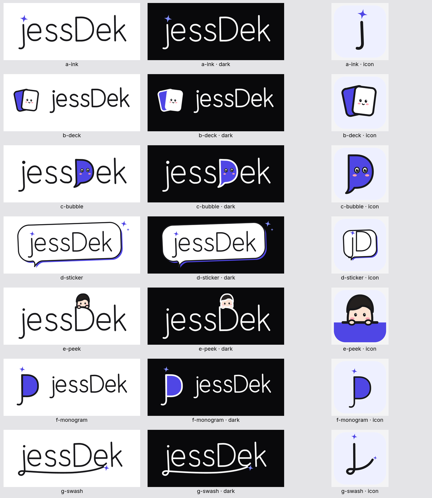

# jessDek logo assets

Seven logo concepts for jessDek, each with a light wordmark, a dark wordmark and a set of app icons. Every file is ready to ship.

- **Start here:** [`/LOGO_PLAN.md`](../../../LOGO_PLAN.md) covers the concepts, where the current logo is used in the codebase, and step-by-step replacement.
- **Overview:** [`boards/finals.png`](boards/finals.png)
- **Ship files:** `concepts/<a-ink | b-deck | c-bubble | d-sticker | e-peek | f-monogram | g-swash>/`
- **History:** `rounds/round-1..6/` and `boards/round-1..6.png`
- **Regenerate:** `node source/export.mjs concepts` (needs `resvg`)

